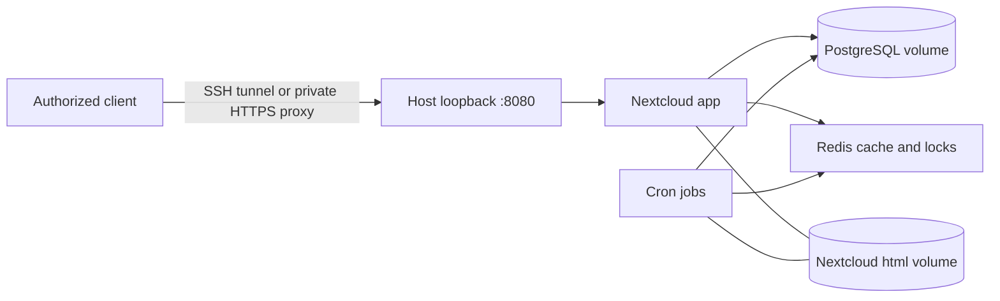

# HomeServer

**A private-by-default Nextcloud starting point for a Debian home server.**

Run Nextcloud, PostgreSQL, Redis and background jobs with Docker Compose; keep
the web backend on localhost; administer it from Windows or Linux; and understand
what must be backed up before trusting it with your files.

**Status: early community starter.** Derived from a personal Debian deployment,
but this generalized version is a separate project. It does not configure your
disks, BIOS, firewall, SSH or VPN, and it is not a production appliance.
The [validation report](docs/validation.md) distinguishes automated tests from
hardware and disaster-recovery tests. [Lire la présentation française](README.fr.md).

The first [Linux integration run](https://github.com/Fogbose/HomeServer/actions/runs/42394077045)
passed: fresh startup, diagnostics, authenticated WebDAV and restart persistence.
Backup recovery, private HTTPS and hardware wake-up still need deployment-specific testing.

## What is included?

- A four-service stack with pinned image versions and digests, persistent named
  volumes, private database/cache network, health checks and bounded container logs.
- An initializer that generates separate passwords and refuses to overwrite
  an existing `.env` or secrets directory.
- A read-only diagnostic command that fails when a service is missing, unhealthy
  or Nextcloud is in maintenance.
- A local Wake-on-LAN sender with preview by default and explicit source/subnet.
- Guides for private HTTPS, backups, isolated recovery, updates and safe power management.
- An optional eleven-app App Store selection, a persistent Memories media image
  and a credential-free client portal generator for Windows, Android and iOS.

No telemetry, cloud account provisioning, automatic image updates, disk cleanup or
automatic shutdown is added. Nextcloud extensions are not automatically installed.

## Requirements

Deployment target: a **64-bit Linux host**, initially Debian 13, with Docker Engine,
Docker Compose Plugin and Python **3.10+** already installed. Windows can administer
the host over SSH and run the Python tests/WOL helper; native Windows deployment
is not supported by this starter. Docker Desktop is not required on the admin PC.

Start with enough RAM for the selected Nextcloud workload and enough reliable
storage for both application data and backup staging. The original deployment
had 8 GB RAM; this is context, not a minimum-memory guarantee. Check
[upstream requirements](https://docs.nextcloud.com/server/stable/admin_manual/installation/system_requirements.html)
and image release/security notes before using the pinned baseline. No claim that
these pins are the latest security releases is made.

## Quick start — new Linux installation

These commands create credentials, download images and start containers. Review
the configuration first; do not run them in an existing personal deployment.
Run Docker commands with `sudo` if your account does not have Docker access.

```sh
git clone https://github.com/Fogbose/HomeServer.git
cd HomeServer
python3 tools/homeserver.py init
# Review non-secret settings in .env before proceeding.
docker compose config -q
docker compose up -d --wait --wait-timeout 600
docker compose exec -T -u www-data app php occ background:cron
python3 tools/homeserver.py check
```

On the server itself, open **http://localhost:8080**. From your admin computer,
create an SSH tunnel using your own already-verified SSH target:

```sh
ssh -N -L 8080:127.0.0.1:8080 YOUR_USER@YOUR_SERVER
```

Then open http://localhost:8080 locally. The SSH connection encrypts the remote
transport. The initial username is `ncadmin`; its password is in the local
`secrets/admin_password` file. Read it only on a trusted terminal, never attach it
to an issue. Change the password in Nextcloud and create non-admin daily accounts.
The bootstrap file does not follow subsequent password changes.

Expected diagnostic: app/db/redis healthy, cron running and a limited-scope JSON
result. This does **not** verify backups, cron's last execution, external HTTPS or
all application functions. Initialization is intentionally not a password-rotation
tool: a second run refuses to overwrite existing files.

> Before importing unique files, configure an external backup and test a restore.
> The default HTTP listener is local only. Do not change it to `0.0.0.0` as a
> shortcut for remote access; follow the [private-access guide](docs/private-access.md).

## Architecture



PostgreSQL and Redis publish no host ports. Redis is disposable cache, not backup.
App and cron also have an outbound network for application needs. All services
share one physical host: this is **not high availability**. See
[architecture and configuration](docs/architecture.md).

## Documentation

| Need | Guide |
| --- | --- |
| Understand storage, variables and permissions | [Architecture](docs/architecture.md) |
| Configure Tailscale HTTPS and family access | [Private access](docs/private-access.md) |
| Add recipes, expenses, groupware and other App Store apps | [Applications](docs/applications.md) |
| Add persistent FFmpeg, ffprobe and ExifTool | [Memories](docs/memories.md) |
| Connect Windows, Android and iOS clients | [Clients](docs/clients.md) |
| Plan coherent backups and isolated recovery | [Backup and restore](docs/backup-restore.md) |
| Diagnose and update the stack | [Operations](docs/operations.md) |
| Understand S3/S5 and local wake-up | [Power and WOL](docs/power.md) |
| Understand actual validation coverage | [Validation](docs/validation.md) |

## Development and contribution

Generate a small offline portal with links to all eleven apps and a client guide:

```sh
python3 tools/build_client_kit.py --server https://cloud.example.org --output client-kit
```

Replace the example origin with your own HTTPS address, then open
`client-kit/Start.html`. The generator refuses to overwrite an existing directory,
does not install clients or store credentials, and supports root-origin deployments.
Keep personalized output private; the default output directory is ignored by Git.
This is a portable link kit, not an automatic account configurator.

The helper uses only the Python standard library. Run the behavior tests locally:

```sh
python3 -m unittest discover -s tests -v
```

GitHub CI additionally validates Compose and starts a disposable stack on a
standard hosted Linux runner. It never connects to a maintainer's home server.
Read [CONTRIBUTING](CONTRIBUTING.md), [support](SUPPORT.md) and the
[security policy](SECURITY.md). Improvements to recovery testing, proxy integration,
hardware compatibility and documentation are welcome. Support is best effort;
there is no uptime, response-time or security-maintenance SLA.

## License and attribution

Project code and documentation: **[MIT](LICENSE)**, copyright 2026 Fogbose.
Nextcloud, PostgreSQL, Redis, Docker and Tailscale retain their own licenses and
trademarks. This repository does not redistribute their images or claim affiliation.
[Upstream references](docs/references.md).
