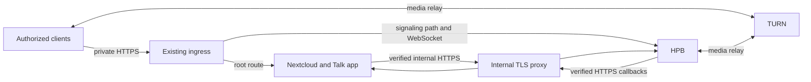

# Optional Talk infrastructure

Talk comprises the Nextcloud App Store app (`spreed`), a signaling/media
high-performance backend (HPB), and usually a TURN relay. Their roles and setup
are described in the [official Talk guide](https://nextcloud-talk.readthedocs.io/en/latest/quick-install/).
This document describes the modular target, **not a tested universal installer**.
The base Compose file deliberately still starts only four Nextcloud services.

Keep the existing Nextcloud root route and add only the signaling path. Use
separate deployment projects for TURN and HPB so either can be serviced without
recreating the Nextcloud stack. Bind backend host ports to loopback; TURN needs
an explicitly reviewed reachable private listener and UDP relay range. A browser
success does not prove UDP media connectivity.

In a private VPN deployment, validate **both directions** of container callbacks.
Host MagicDNS success does not prove Docker DNS resolution or access back through
the host's private listener. A narrowly scoped internal TLS proxy can resolve the
canonical hostname inside Docker while presenting its valid hostname certificate.
Do not disable TLS verification or change the client's public origin to work around
this. Keep certificate keys private and renew/reload atomically after validation.

Configure separate random signaling/backend and TURN REST secrets outside Git.
Review host firewall and VPN policy together: client-to-TURN and HPB-to-TURN may
need distinct rules. Example deployment choices are TCP/UDP 3478 and a bounded
UDP relay range; match the actual coturn configuration, not a copied host policy.
No public router port, Funnel or broad firewall bypass is implied.

## Maintenance and acceptance

Record image digests, architecture, configuration and previous working images.
Update components in a test environment, verify backups, then schedule production.
Confirm signaling status, WebSocket upgrade, authenticated callbacks and a real
two-device call with audio/video in both directions; test background notifications
separately. No call recording, SIP bridge or public guest access is enabled here.

The originating AIO Talk deployment generates media TURN credentials valid for
90 days at HPB startup. Certificate renewal does not refresh them. For that pinned
implementation, schedule an idle HPB restart monthly, always before expiry; verify
this behavior again when changing the image. Automatic restart needs reliable
active-call detection/draining and must not blindly interrupt calls.

Back up service configuration, secret material and certificate renewal units in
addition to Nextcloud's files/database. The starter's base backup procedure must
be extended explicitly for these optional services. Restore in isolation first.

References: [standalone signaling](https://github.com/strukturag/nextcloud-spreed-signaling),
[AIO Talk source](https://github.com/nextcloud/all-in-one/tree/main/Containers/talk),
[TURN setup](https://nextcloud-talk.readthedocs.io/en/latest/TURN/).
